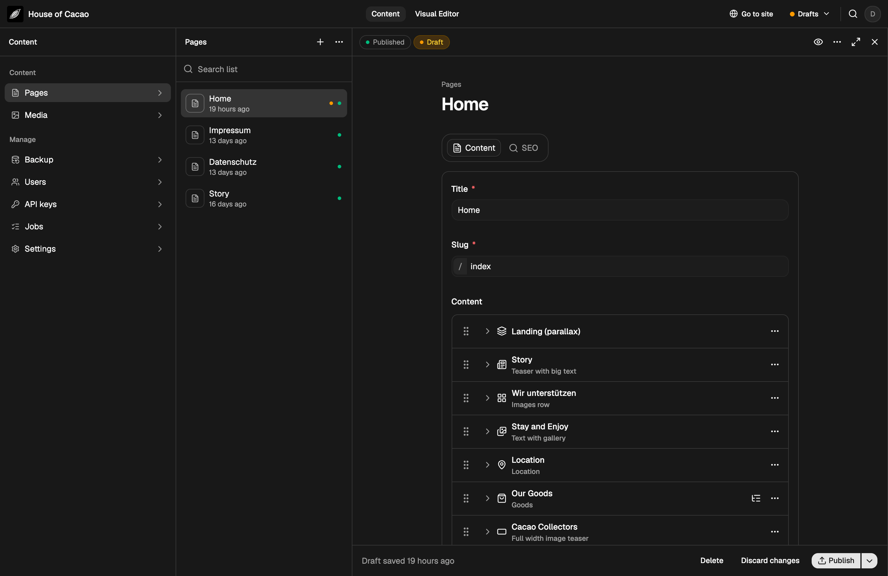

<p align="center">
  <a href="https://github.com/SuddenDev/TenonCMS">
    <picture>
      <source media="(prefers-color-scheme: dark)" srcset="https://raw.githubusercontent.com/SuddenDev/TenonCMS/main/docs/public/logo/tenon-logo-dark.svg">
      
    </picture>
  </a>
</p>

<p align="center">
  <strong>The monolithic headless CMS.</strong>
  <br>
  The admin, the API and your content run in the app you already deploy.
  <br>
  Schema in TypeScript. Data in your own database. Free and MIT licensed.
</p>

<p align="center">
  <a href="https://www.npmjs.com/package/tenoncms"></a>
  <a href="https://github.com/SuddenDev/TenonCMS/actions/workflows/ci.yml"></a>
  <a href="https://github.com/SuddenDev/TenonCMS/blob/main/LICENSE"></a>
</p>

<p align="center">
  <a href="https://tenoncms.com/docs/core/getting-started/quick-start"><strong>Get started »</strong></a>
  &middot;
  <a href="https://tenoncms.com/docs/core/getting-started/introduction">Read the docs</a>
  &middot;
  <a href="https://github.com/SuddenDev/TenonCMS/issues/new?labels=bug">Report a bug</a>
  &middot;
  <a href="https://github.com/SuddenDev/TenonCMS/issues/new?labels=enhancement">Request a feature</a>
</p>

<p align="center">
  
</p>

> **Status:** Tenon is in version 0.x and not yet in beta. Most things work well, but a minor version can still bring breaking changes. Read the [release notes](https://github.com/SuddenDev/TenonCMS/releases) before you upgrade.

## About

Most headless CMSs work with any framework because they talk REST or GraphQL. The price is a second service, with its own deployment and its own database server. A hosted CMS ties you and your content to a vendor. A self-hosted one is one more service to deploy, secure and keep in sync.

Tenon takes the other route. It is a package you add to your [Vite](https://vite.dev)-based app, and the admin and the API become routes of that app:

- One repo, one deploy, one database
- Server code reads content with a function call, without HTTP
- Types flow from your schema into your pages

### See it in action

https://github.com/user-attachments/assets/cb3e7e26-48cb-42e9-829d-0b81afeff1c9

### Works with your stack

|                | Supported                                                   |
| -------------- | ----------------------------------------------------------- |
| **Frameworks** | Astro, Nuxt, TanStack Start, standalone. More to come.      |
| **Databases**  | SQLite, Turso, Postgres, PGlite, Cloudflare Durable Objects |
| **Media**      | Local disk, S3-compatible storage, Cloudflare R2            |
| **Deployment** | Node, Vercel, Cloudflare                                    |

## Getting started

### Prerequisites

- **Node.js 24 or newer.** Odd-numbered versions like v23 are not supported.
- **A server runtime.** The admin and the API are server routes, so a purely static host cannot run them. Your pages can still be prerendered.

### Create a project

Run the wizard and pick your framework, database and media storage:

```sh
# or pnpm, yarn or bun
npm create tenoncms@latest
```

Start the dev server:

```sh
cd my-site
npm run dev
```

Open the URL the dev server prints and add `/admin`. Create your account. The first account is the admin. After that, sign-up closes and admins invite everyone else.

The starter comes with a **Posts** collection. Create a post and select **Publish**. Your home page now lists it.

To add Tenon to an app you already have, see [Add to an existing site][existing-site].

## Usage

### Describe your content

A collection is a list of documents with the same fields. Write it in TypeScript:

```ts
// cms/collections/posts.ts
import { defineCollection } from "tenoncms";

export const posts = defineCollection({
  titleField: "title",
  fields: {
    title: { type: "text", required: true },
    slug: { type: "slug", from: "title", unique: true },
    body: { type: "richtext" },
  },
});
```

### Connect it in one config file

`tenon.config.ts` holds the collections, the database, media, email and sign-in:

```ts
// tenon.config.ts
import { defineCms } from "tenoncms";
import { sqlite } from "tenoncms/sqlite";
import { posts } from "./cms/collections/posts";

export default defineCms({
  collections: { posts },
  database: sqlite("./cms.db"),
  secret: process.env.TENON_SECRET!,
});
```

### Read it from your pages

Server code calls the CMS directly. The result is typed from the schema, so a typo in a field name fails the type check:

```ts
import cms from "./tenon.config";

const [post] = await cms.find("posts", { where: { slug: "hello" }, limit: 1 });

console.log(post?.title);
```

The HTTP API and the admin run through the same functions, with the same validation and access rules.

### Manage it from the terminal

The `tenon` CLI comes with the package:

```sh
npx tenon backup
npx tenon restore tenon-my-site-2026-11-12-1530.zip
npx tenon users create editor@example.com
```

For more, read [Configuration][configuration] and [How Tenon works][how-it-works].

## Features

- **[Content modeling][content-modeling]:** collections, globals, fields, relations, lists and blocks
- **[Drafts and versions][reading]:** drafts, scheduled publishing and a version history
- **[Localization][localization]:** localized content and a localized admin
- **[Pages and SEO][pages-and-seo]:** nested pages, SEO fields, sitemap, `robots.txt` and menus
- **[Live preview][live-preview]:** a visual editor and an admin bar on your own pages
- **[Media][media]:** a media library with image transformations
- **[Users and access][access-control]:** password, passkey, magic link or email code, with roles, invites, access rules and API keys
- **[Operations][operations]:** SMTP email, background jobs, cron schedules, webhooks, backup and restore
- **[Customization][customization]:** your own fields, admin pages, styles and plugins
- **[HTTP API][http-api]:** a REST API with a typed browser client, for a frontend on another origin

## Built with

| Library                                                                                           | What it does in Tenon           |
| ------------------------------------------------------------------------------------------------- | ------------------------------- |
| [Hono](https://hono.dev)                                                                          | The HTTP API, on web standards  |
| [Vite](https://vite.dev)                                                                          | Bundles the admin with your app |
| [Kysely](https://kysely.dev)                                                                      | SQL on every supported database |
| [Better Auth](https://better-auth.com)                                                            | Sign-in, sessions and passkeys  |
| [Zod](https://zod.dev)                                                                            | Validation from the schema      |
| [Tiptap](https://tiptap.dev)                                                                      | The rich text editor            |
| [Vue](https://vuejs.org), [Reka UI](https://reka-ui.com), [Tailwind CSS](https://tailwindcss.com) | The admin                       |

## Documentation

| Section                              | What it covers                                           |
| ------------------------------------ | -------------------------------------------------------- |
| [Getting started][getting-started]   | Quick start, existing sites, configuration, how it works |
| [Content modeling][content-modeling] | Collections, globals, fields, relations, media           |
| [Working with content][reading]      | Reading, writing, the HTTP API, localization, hooks      |
| [Building your site][pages-and-seo]  | Pages and SEO, components, menus, live preview           |
| [Frameworks][frameworks]             | Astro, Nuxt, TanStack Start, standalone, others          |
| [Deployment][deployment]             | Node, Vercel, Cloudflare                                 |
| [Databases and storage][databases]   | Databases, media storage, image providers                |
| [CLI][cli]                           | `create-tenoncms` and the `tenon` command                |

## Roadmap

**Done**

- [x] Collections, globals, relations, lists and blocks, inferred types
- [x] Hooks, validation, conditions, drafts, scheduled publishing, versions
- [x] Localization, pages and SEO, sitemap and robots, menus
- [x] Live preview, admin bar, components for Vue, React and Astro
- [x] Rich text (Tiptap) with extensions, media library with local, S3 and R2 storage
- [x] Image providers, including Vercel
- [x] Users, roles, invites, access rules, API keys, edit locks
- [x] Jobs and cron, webhooks, plugins, SMTP email
- [x] Postgres and PGlite, Vercel, Cloudflare (Durable Objects)
- [x] Backup and restore, seeding, `create-tenoncms`, the `tenon` CLI

**Next**

- [ ] The docs site, then the first beta release
- [ ] Cloudflare for Nuxt, TanStack Start and standalone

**Planned**

- [ ] Search in the admin, later full-text search
- [ ] Redirects created on path changes
- [ ] Caching of public reads, purged on publish
- [ ] The admin on phones
- [ ] OpenAPI spec

**Later**

- [ ] SvelteKit, multiplayer and presence, trash, content migrations, SDKs

Missing something? [Open an issue](https://github.com/SuddenDev/TenonCMS/issues/new?labels=enhancement).

## Contributing

Issues and pull requests are welcome. For a bigger change, open an issue first.

```sh
pnpm install
pnpm dev:astro      # or dev:nuxt, dev:tanstack, dev:standalone
```

Each example needs a `.env` with a secret of 32 or more characters (`TENON_SECRET`, in Nuxt `NUXT_TENON_SECRET`). Copy its `.env.example` and create a secret with `openssl rand -hex 32`. The example runs on its own port (Astro: `http://localhost:4321/admin`). The admin playground with hot reload runs on `http://localhost:5173/admin/`.

| Command                              | What it does                                                    |
| ------------------------------------ | --------------------------------------------------------------- |
| `pnpm test`                          | Unit and integration tests                                      |
| `pnpm test:full`                     | Also the integration tests on PGlite, `node:sqlite` and workerd |
| `pnpm typecheck`                     | Builds the packages, then type-checks everything                |
| `pnpm lint` / `pnpm fmt`             | oxlint and oxfmt. The pre-commit hook runs both.                |
| `pnpm smoke:templates <fw> <target>` | Scaffolds and builds a starter (run `pnpm tarball` first)       |

Before you open a pull request:

1. Write a failing test first, then the fix or feature.
2. Run `pnpm typecheck` and `pnpm test`. For database changes, also run `pnpm test:full`.
3. Update the docs in `docs/content/docs` in the same change.
4. Use [conventional commits](https://www.conventionalcommits.org) (`feat:`, `fix:`, `docs:`). The release notes are generated from them.

To learn more, read [AGENTS.md][agents-md] for the commands, rules and code style, and [dev/][dev] for the design decisions, known traps, smoke tests and releasing.

<details>
  <summary>Repository layout</summary>

```
packages/core             tenoncms: schema, API, admin integration, adapters
packages/admin            the Vue admin, built into core (private)
packages/plugins          bundled plugins (private)
packages/create-tenoncms  create-tenoncms: the project scaffolder
templates/                the starters of create-tenoncms
examples/                 Astro, Astro + PGlite, Nuxt, TanStack Start, standalone, Vercel, Cloudflare
docs/                     the docs site
```

</details>

## A note on AI

I built this project fast, with the help of AI tools. I wanted to have something like this for my business for a long time and give something back to the Open Source community. I hope it is obvious that this is not slop and that I care about this project. I plan to maintain it for as long as I need it and find it useful. Contributions or forks are ofc. always welcome. If you have concerns about security, code quality or anything else, please open an issue or contact me.

## Acknowledgments

- [Pruvious](https://pruvious.com): the Nuxt-integrated CMS this idea comes from
- [Payload 3](https://payloadcms.com): schema in code, embedded in Next.js
- [Sanity](https://sanity.io)

## License

[MIT](https://github.com/SuddenDev/TenonCMS/blob/main/LICENSE)

<!-- Absolute links, because the README also ships to npm. -->

[agents-md]: https://github.com/SuddenDev/TenonCMS/blob/main/AGENTS.md
[dev]: https://github.com/SuddenDev/TenonCMS/tree/main/dev
[getting-started]: https://tenoncms.com/docs/core/getting-started/introduction
[existing-site]: https://tenoncms.com/docs/core/getting-started/existing-site
[configuration]: https://tenoncms.com/docs/core/getting-started/configuration
[how-it-works]: https://tenoncms.com/docs/core/getting-started/how-tenon-works
[content-modeling]: https://tenoncms.com/docs/core/content-modeling/collections-and-globals
[media]: https://tenoncms.com/docs/core/content-modeling/media
[reading]: https://tenoncms.com/docs/core/working-with-content/reading
[http-api]: https://tenoncms.com/docs/core/working-with-content/http-api-and-client
[localization]: https://tenoncms.com/docs/core/working-with-content/localization
[pages-and-seo]: https://tenoncms.com/docs/core/building-your-site/pages-and-seo
[live-preview]: https://tenoncms.com/docs/core/building-your-site/live-preview
[access-control]: https://tenoncms.com/docs/core/users-and-access/access-control
[customization]: https://tenoncms.com/docs/core/customization
[operations]: https://tenoncms.com/docs/core/operations
[frameworks]: https://tenoncms.com/docs/guide/frameworks
[deployment]: https://tenoncms.com/docs/guide/deployment
[databases]: https://tenoncms.com/docs/guide/databases-and-storage/databases
[cli]: https://tenoncms.com/docs/cli/overview
